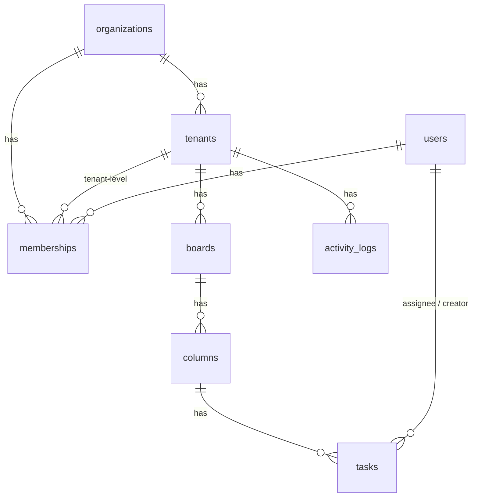

# Data model

Hierarchy: **organization -> tenant (branch) -> board -> column -> task**.

| Table | Notes |
|---|---|
| `memberships` | `tenant_id IS NULL` means org-level (`org_admin`). Otherwise `tenant_admin` or `member` in that tenant. A CHECK constraint enforces this. |
| `columns`, `tasks` | Carry `tenant_id`. Composite foreign keys `(board_id, tenant_id)` and `(column_id, tenant_id)` mean the database refuses a column or task that points into another tenant. Tested. |
| `tasks.position` | REAL, fractional ordering. Moving a task writes one row. |
| `tasks.version`, `field_versions` | Per-field optimistic concurrency (see INTERVIEW.md). |
| `tasks.deleted_at` | Soft delete, which makes undo possible. |
| `activity_logs` | Written in the same transaction as the change it describes. |
